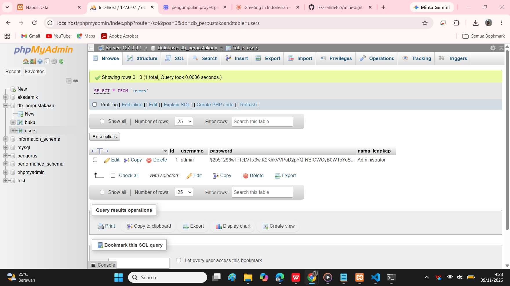
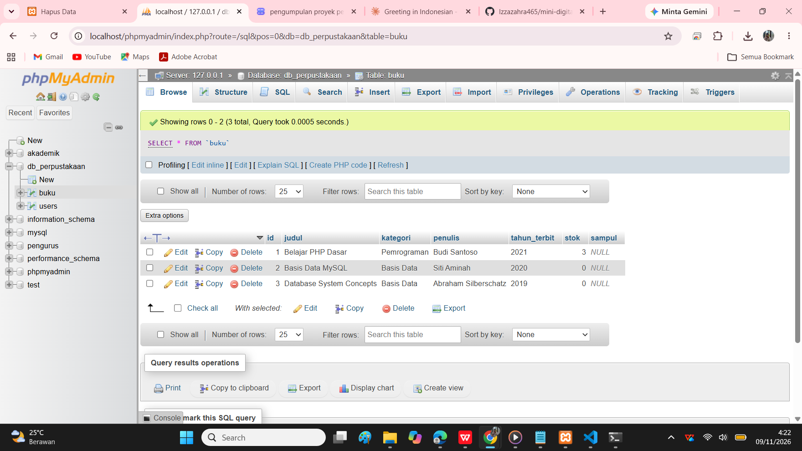
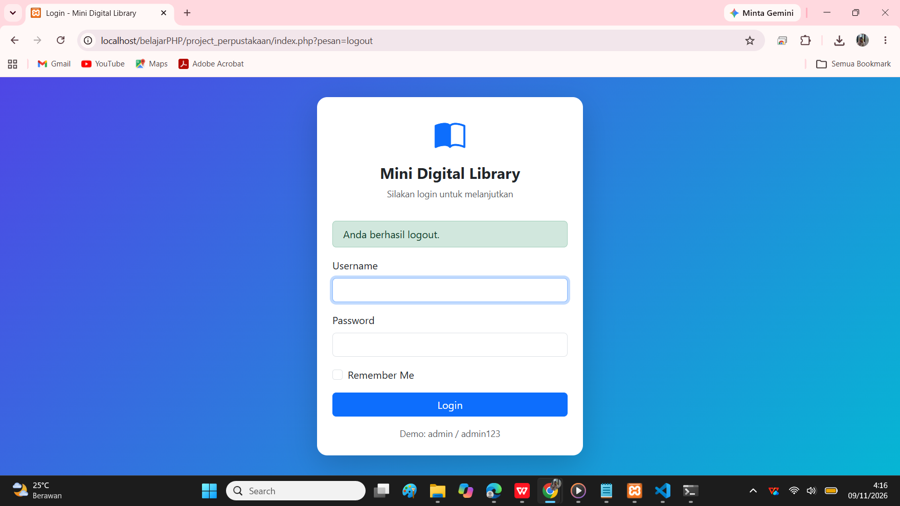
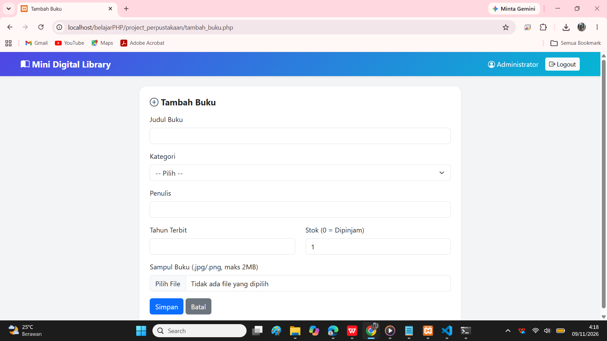
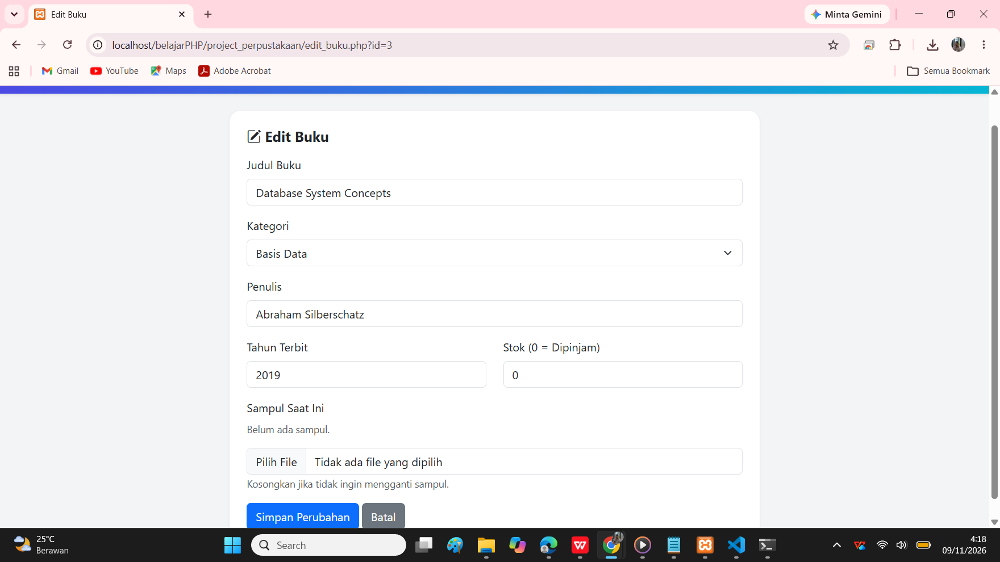

# Sistem Informasi Perpustakaan Digital Mini (Mini Digital Library)

## Deskripsi Aplikasi

Aplikasi web **pengelolaan data buku perpustakaan** berbasis **PHP Native** dan **MySQL** yang dilengkapi **autentikasi pengguna**. Admin dapat login, mengelola data buku (tambah, lihat, ubah, hapus), mengunggah **sampul buku**, dan melihat **status ketersediaan** setiap buku secara otomatis.

Halaman utama (`/`) adalah **halaman login**. Pengguna yang sudah login otomatis diarahkan ke **dashboard**, sedangkan pengguna yang belum login tidak dapat mengakses halaman pengelolaan data.

## Fitur Utama

| Modul | Fitur |
|---|---|
| **Autentikasi** | Login dengan form POST, password disimpan sebagai hash bcrypt, proteksi halaman memakai **Session**, opsi **Remember Me** memakai **Cookie** (menyimpan username 7 hari), dan **Logout** yang menghapus session serta cookie |
| **Data Buku (CRUD)** | **Create** (judul, kategori, penulis, tahun terbit, stok), **Read** (tabel di dashboard dengan total buku), **Update**, dan **Delete** dengan konfirmasi |
| **Upload Sampul** | Hanya `.jpg` / `.png`, maksimal **2MB**, dicek ekstensi dan tipe asli file. Saat sampul diganti atau buku dihapus, **file lama ikut dihapus** dari folder `uploads/` |
| **Logika Status** | Stok lebih dari 0 menampilkan **Tersedia**, stok 0 menampilkan **Dipinjam** |
| **Tampilan** | UI responsif memakai Bootstrap 5 dan Bootstrap Icons |

## Teknologi

- PHP Native (tanpa framework) dengan ekstensi `mysqli` dan prepared statement
- MySQL / MariaDB
- Bootstrap 5, Bootstrap Icons
- Git dan GitHub

## Cara Menjalankan

1. Salin folder project ke `htdocs` XAMPP, lalu nyalakan **Apache** dan **MySQL**.
2. Buka phpMyAdmin, lalu **Import** file `db_perpustakaan.sql`.
3. Sesuaikan kredensial database di `config/koneksi.php` jika perlu.
4. Buka `http://localhost/belajarPHP/project_perpustakaan/`
5. Login dengan akun demo:

| Username | Password |
|---|---|
| `admin` | `admin123` |

## Struktur Folder

```
project_perpustakaan/
├── config/
│   ├── koneksi.php      # Koneksi database
│   ├── auth.php         # Pengecekan session
│   ├── upload.php       # Fungsi upload, hapus file, label status
│   ├── header.php       # Template atas
│   └── footer.php       # Template bawah
├── uploads/             # Penyimpanan sampul buku
├── screenshots/         # Gambar dokumentasi
├── index.php            # Halaman login
├── proses_login.php     # Verifikasi login, session, cookie
├── logout.php           # Hapus session dan cookie
├── dashboard.php        # Tampil data buku
├── tambah_buku.php      # Form tambah
├── proses_tambah.php    # Insert dan upload
├── edit_buku.php        # Form edit
├── proses_edit.php      # Update dan ganti sampul
├── hapus_buku.php       # Delete dan hapus file
└── db_perpustakaan.sql  # Ekspor database
```

## Struktur Database

### Tabel `users`


### Tabel `buku`


## Tampilan Aplikasi

### Halaman Login


### Dashboard


### Tambah Buku


### Edit Buku


## Video Demo

Tonton demo aplikasi di YouTube: https://youtu.be/tAAPgxaoHh0

## Pembuat

**Izza Zahra Syabana Wahid**: Mata Kuliah Pemrograman Web, Program Studi Sistem Informasi